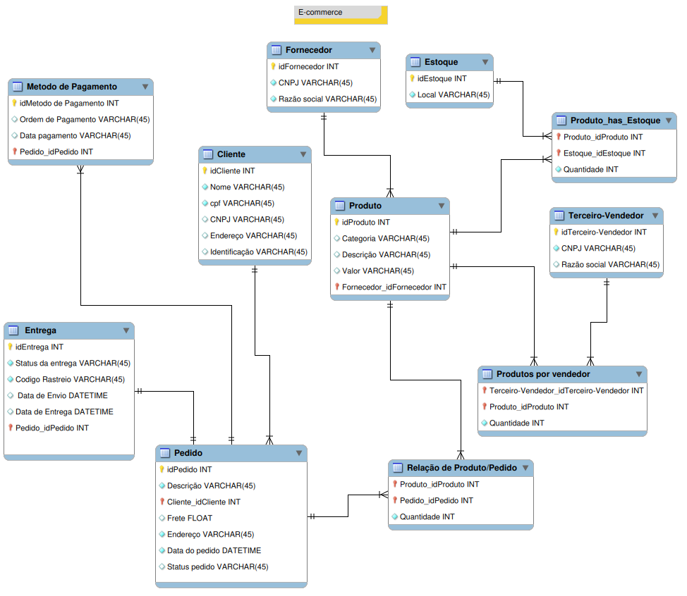

# 🛒 Refinando um Projeto Conceitual de Banco de Dados – E-commerce

Projeto da formação **SQL Database Specialist (DIO)**: refinamento do modelo
conceitual de um e-commerce, desenvolvido no MySQL Workbench.

## 📌 Narrativa

**Produto**
- Vendido por uma única plataforma online, podendo ter vendedores terceiros.
- Cada produto possui um fornecedor.
- Um ou mais produtos compõem um pedido.

**Cliente**
- Cadastro com CPF ou CNPJ.
- O endereço determina o valor do frete.
- Pode fazer mais de um pedido, com período de carência para devolução.

**Pedido**
- Criado por clientes, com informações de compra, endereço e status da entrega.
- Pode ser cancelado.

## 🗺️ Diagrama

## 🧩 Entidades

| Entidade | Descrição |
|---|---|
| Cliente | Pessoa física (CPF) ou jurídica (CNPJ), com endereço |
| Pedido | Compra do cliente, com status, frete e endereço de entrega |
| Entrega | Status, código de rastreio e datas (1:1 com Pedido) |
| Metodo de Pagamento | Pagamentos de um pedido |
| Produto | Item vendido, ligado a um fornecedor |
| Fornecedor | Quem fornece o produto |
| Terceiro-Vendedor | Vendedor externo (N:N com Produto) |
| Estoque | Local de estoque (N:N com Produto) |

## 🔗 Principais relacionamentos

- Cliente **1:N** Pedido
- Pedido **1:1** Entrega
- Pedido **1:N** Metodo de Pagamento
- Fornecedor **1:N** Produto
- Pedido **N:N** Produto (tabela `Relação de Produto/Pedido`)
- Produto **N:N** Terceiro-Vendedor (tabela `Produtos por vendedor`)
- Produto **N:N** Estoque (tabela `Produto_has_Estoque`)

## 💡 Decisões de modelagem

- **CPF ou CNPJ:** o cliente possui os dois campos, e apenas o aplicável ao seu perfil (pessoa física ou jurídica) é preenchido.
- **Entrega separada do pedido:** o status da entrega (`Entrega`) é independente do status do pedido (`Pedido.Status pedido`), que registra inclusive o cancelamento.
- **Carência de devolução:** pode ser calculada a partir de `Entrega.Data de Entrega`.
- **Fornecedor:** cada produto possui um único fornecedor (FK em `Produto`).
- **Pagamento:** um pedido pode ter mais de um pagamento (`Metodo de Pagamento`).

## 📁 Arquivos

- `Ecommerce_refinado.png`: diagrama do modelo (MySQL Workbench)

## 🛠️ Tecnologias

MySQL · MySQL Workbench
