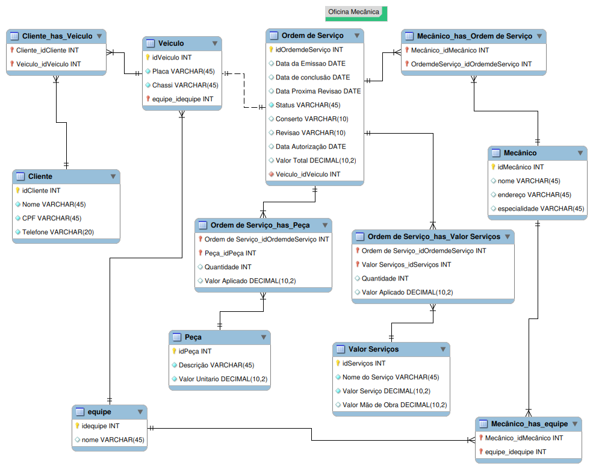

# 🔧 Esquema Conceitual – Oficina Mecânica

Projeto da formação **SQL Database Specialist (DIO)**: esquema conceitual criado
do zero, no MySQL Workbench, para um sistema de controle e gerenciamento da
execução de ordens de serviço (OS) em uma oficina mecânica.

## 📌 Narrativa

- Sistema de controle e gerenciamento de execução de ordens de serviço em uma oficina mecânica.
- Clientes levam veículos à oficina para conserto ou revisões periódicas.
- Cada veículo é designado a uma equipe de mecânicos, que identifica os serviços a executar e preenche uma OS com data de entrega.
- A partir da OS, calcula-se o valor de cada serviço consultando uma tabela de referência de mão de obra.
- O valor de cada peça também compõe a OS.
- O cliente autoriza a execução dos serviços.
- A mesma equipe avalia e executa os serviços.
- Os mecânicos possuem código, nome, endereço e especialidade.
- Cada OS possui: nº, data de emissão, valor, status e data para conclusão dos trabalhos.

## 🗺️ Diagrama

## 🧩 Entidades

| Entidade | Atributos | Descrição |
|---|---|---|
| Cliente | idCliente (PK), Nome, CPF, Telefone | Quem leva o veículo à oficina e autoriza os serviços |
| Veículo | idVeiculo (PK), Placa, Chassi, equipe_idequipe (FK) | Veículo atendido, designado a uma equipe |
| Equipe | idequipe (PK), nome | Grupo de mecânicos que avalia e executa os serviços |
| Mecânico | idMecânico (PK), nome, endereço, especialidade | Profissional da oficina (o código é o `idMecânico`) |
| Ordem de Serviço | idOrdemdeServiço (PK), Data da Emissão, Data de conclusão, Data Próxima Revisão, Status, Conserto, Revisão, Data Autorização, Valor Total, Veiculo_idVeiculo (FK) | Documento que controla a execução dos serviços |
| Valor Serviços | idServiços (PK), Nome do Serviço, Valor Serviço, Valor Mão de Obra | Tabela de referência de serviços e mão de obra |
| Peça | idPeça (PK), Descrição, Valor Unitário | Peças que compõem o valor da OS |

### Entidades associativas (relacionamentos N:N)

| Tabela | Relaciona | Atributos próprios |
|---|---|---|
| Cliente_has_Veículo | Cliente ↔ Veículo | – |
| Mecânico_has_Equipe | Mecânico ↔ Equipe | – |
| Mecânico_has_Ordem de Serviço | Mecânico ↔ Ordem de Serviço | – |
| Ordem de Serviço_has_Valor Serviços | Ordem de Serviço ↔ Valor Serviços | Quantidade, Valor Aplicado |
| Ordem de Serviço_has_Peça | Ordem de Serviço ↔ Peça | Quantidade, Valor Aplicado |

## 🔗 Principais relacionamentos

- Cliente **N:N** Veículo (via `Cliente_has_Veículo`)
- Equipe **1:N** Veículo (cada veículo é designado a uma equipe)
- Veículo **1:N** Ordem de Serviço
- Mecânico **N:N** Equipe (via `Mecânico_has_Equipe`)
- Mecânico **N:N** Ordem de Serviço (via `Mecânico_has_Ordem de Serviço`)
- Ordem de Serviço **N:N** Valor Serviços (via `Ordem de Serviço_has_Valor Serviços`)
- Ordem de Serviço **N:N** Peça (via `Ordem de Serviço_has_Peça`)

## 💡 Premissas e decisões de modelagem

Pontos que a narrativa não definia e como foram interpretados:

- **Cliente e Veículo:** a narrativa não detalha esses atributos. Defini CPF, nome e telefone para o cliente, e placa e chassi para o veículo. O relacionamento é N:N porque um cliente pode levar vários veículos e um mesmo veículo pode mudar de proprietário ao longo do tempo.
- **Designação à equipe:** conforme a narrativa ("cada veículo é designado a uma equipe"), a FK da equipe fica em `Veículo`. Como a mesma equipe avalia e executa os serviços, não há ligação separada entre equipe e OS.
- **Mecânicos e equipes:** um mecânico pode atuar em mais de uma equipe, por isso a relação é N:N. O "código" do mecânico é o `idMecânico`.
- **Mecânicos e OS:** a tabela `Mecânico_has_Ordem de Serviço` registra quais mecânicos executaram cada OS.
- **Tipo da OS:** os campos `Conserto` e `Revisão` indicam o motivo da visita. Para revisões periódicas, `Data Próxima Revisão` guarda a data da revisão seguinte.
- **Datas da OS:** "data de entrega" e "data para conclusão dos trabalhos" foram tratadas como a mesma informação, o campo `Data de conclusão`.
- **Autorização do cliente:** registrada pelo campo `Data Autorização` na OS. A execução só começa após essa data estar preenchida.
- **Vários serviços e peças por OS:** como a narrativa fala em "o valor de cada serviço" e "de cada peça", uma OS pode ter vários serviços e várias peças, resolvido pelas tabelas associativas `Ordem de Serviço_has_Valor Serviços` e `Ordem de Serviço_has_Peça`, que guardam a quantidade e o valor aplicado.
- **Tabela de referência de mão de obra:** representada pela entidade `Valor Serviços`. Ao incluir um serviço na OS, o valor de referência é copiado para `Valor Aplicado`, preservando o histórico caso a tabela mude. O mesmo vale para o valor unitário da peça.
- **Valor da OS:** `Valor Total` é a soma de `Quantidade × Valor Aplicado` de todos os serviços e peças da OS.

## 📁 Arquivos

- `Oficina_Mecanica_refinado.png`: diagrama do esquema (MySQL Workbench)

## 🛠️ Tecnologias

MySQL · MySQL Workbench
